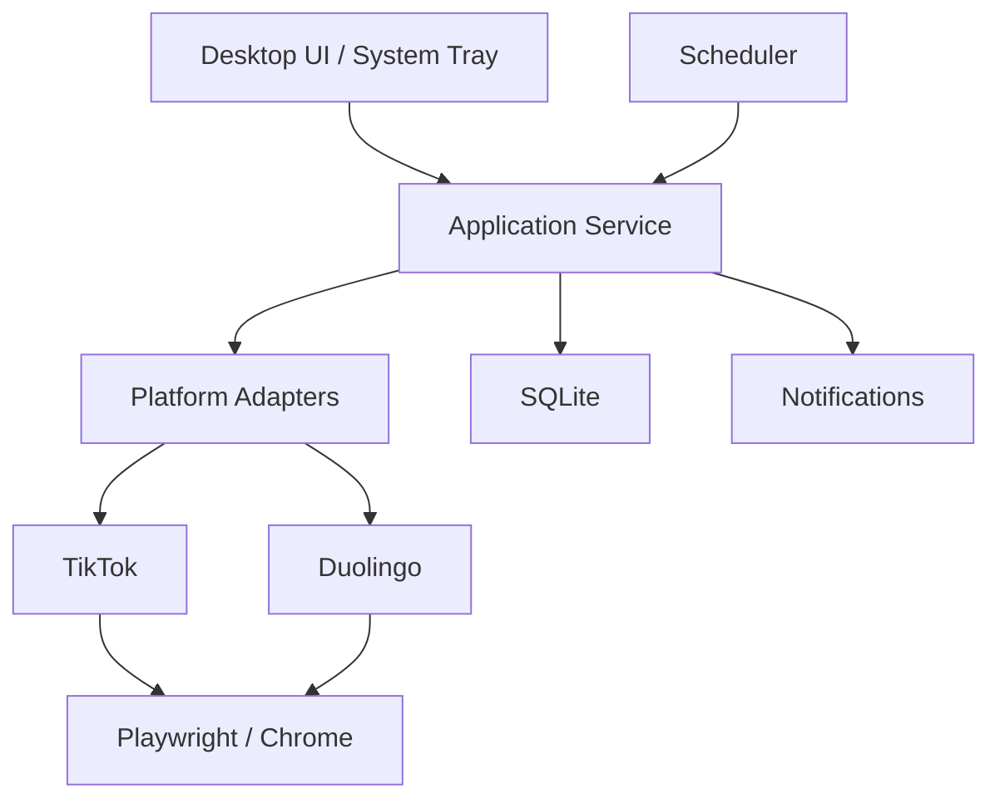

# StreakKeeper — Project Brief

> Phiên bản 0.1 | Tài liệu khởi tạo dự án

## 1. Tổng quan

StreakKeeper là ứng dụng desktop hỗ trợ người dùng quản lý và duy trì chuỗi hoạt động hằng ngày trên TikTok và Duolingo. Ứng dụng chạy local trên laptop, sử dụng Google Chrome và ưu tiên trải nghiệm đơn giản: cấu hình một lần, chạy nền, chỉ thông báo khi cần can thiệp.

**Mục tiêu:** giảm nguy cơ quên duy trì streak, giảm thao tác lặp lại và quản lý nhiều chuỗi tại một nơi.

## 2. Các quyết định đã chốt

| Thành phần | Quyết định |
|---|---|
| Nền tảng | Desktop (laptop) |
| Trình duyệt | Google Chrome, phiên bản đã cài trên máy |
| Browser automation | Playwright |
| Ngôn ngữ | Python |
| UI | PySide6 |
| Scheduler | APScheduler |
| Database | SQLite |
| Đóng gói | PyInstaller |
| Kiến trúc | Local-first, không cần backend |
| Tài khoản | Đăng nhập trực tiếp trên website chính thức trong Chrome profile riêng |
| Định hướng | Open-source, ưu tiên quyền riêng tư |

Không triển khai mobile app, browser extension, AI agent, hệ thống cloud hoặc hỗ trợ nhiều trình duyệt trong MVP.

## 3. Phạm vi sản phẩm (MVP)

### TikTok

- Kết nối tài khoản qua Chrome.
- Quản lý danh sách bạn bè có streak cần theo dõi.
- Hiển thị số ngày streak nếu website cung cấp thông tin.
- Kiểm tra tình trạng hoạt động trong ngày và nhắc người dùng khi chưa hoàn thành.
- Hỗ trợ mở cuộc trò chuyện để người dùng thực hiện hoặc xác nhận tương tác.

### Duolingo

- Kết nối tài khoản qua Chrome.
- Hiển thị streak, khóa học và trạng thái bài học nếu có thể xác minh từ giao diện.
- Nhắc người dùng học khi chưa hoàn thành mục tiêu ngày.
- Mở trang học để người dùng tự hoàn thành bài học.

### Chức năng chung

- Lập lịch kiểm tra theo múi giờ của người dùng.
- Kiểm tra ngay theo yêu cầu, bật/tắt tác vụ nền.
- Hiển thị lịch sử kiểm tra, lỗi và thời điểm chạy tiếp theo.
- Thông báo khi cần đăng nhập lại hoặc khi chuỗi có nguy cơ bị gián đoạn.
- Thu nhỏ vào system tray và tùy chọn khởi động cùng hệ điều hành.

**Giới hạn:** chỉ tự động hóa những thao tác được nền tảng cho phép; không vượt qua xác minh bảo mật, CAPTCHA hoặc giới hạn truy cập. Chức năng tự động gửi nội dung hoặc hoàn thành hoạt động cần được đánh giá riêng về quyền, điều khoản và tính khả thi trước khi triển khai. Không cam kết mọi chuỗi đều được giữ tự động.

## 4. Kiến trúc



- **UI:** hiển thị dữ liệu, nhận yêu cầu từ người dùng.
- **Application Service:** điều phối tác vụ và trạng thái.
- **Scheduler:** quyết định thời điểm kiểm tra, xử lý tác vụ bị bỏ lỡ.
- **Platform Adapters:** tách logic TikTok và Duolingo để dễ bảo trì khi giao diện thay đổi.
- **Browser Manager:** quản lý vòng đời Chrome profile dành riêng cho ứng dụng.
- **Repository:** lưu cài đặt, trạng thái và lịch sử trong SQLite.
- **Notification Service:** thông báo khi người dùng cần chú ý.

## 5. Kết nối tài khoản và Chrome

1. Kiểm tra máy đã cài Google Chrome.
2. Người dùng bấm Connect trên giao diện.
3. Mở Chrome với profile riêng dành cho ứng dụng.
4. Người dùng tự đăng nhập trên website chính thức và xác nhận kết nối.
5. Những lần kiểm tra sau sử dụng phiên hợp lệ của profile này.
6. Khi phiên hết hạn hoặc cần xác minh, dừng tác vụ và thông báo người dùng.

Chrome cá nhân vẫn hoạt động bình thường. Không đọc hay sao chép cookie từ profile mặc định, không yêu cầu mật khẩu trong giao diện StreakKeeper. Chỉ khởi chạy trình duyệt khi cần; đóng trình duyệt do app quản lý sau tác vụ nếu phù hợp.

## 6. UI/UX

Phong cách desktop utility, kích thước tham chiếu 1000 × 680 px; giao diện tối giản, màu cam làm điểm nhấn, hỗ trợ light/dark mode. Tham khảo Raycast, Linear và PowerToys.

| Màn hình | Nội dung chính |
|---|---|
| Dashboard | Trạng thái hôm nay, các streak, lần kiểm tra tiếp theo, Check now, bật/tắt tác vụ nền |
| TikTok | Tài khoản đã kết nối, danh sách bạn bè, streak, trạng thái, bật/tắt theo dõi |
| Duolingo | Tài khoản, streak, khóa học, trạng thái hôm nay, lịch hoạt động, mở Duolingo |
| Activity Log | Thời gian, nền tảng, kết quả, lỗi, bộ lọc |
| Settings | Tài khoản, lịch chạy, thông báo, giao diện, startup, quyền riêng tư |
| System Tray | Tình trạng tổng quan, Check now, Pause, Open dashboard, Quit |

Các trạng thái cần thiết: loading, empty, disconnected, pending, completed, failed, skipped, needs attention, unknown. Không hiển thị Completed nếu chưa xác minh được kết quả.

## 7. Privacy & Security

- Local-first: không gửi phiên đăng nhập, thông tin cá nhân hay lịch sử tin nhắn lên server.
- Không thu mật khẩu; người dùng tự thực hiện đăng nhập.
- Giới hạn dữ liệu và quyền truy cập ở mức cần thiết; bảo vệ thư mục profile và dữ liệu nhạy cảm bằng cơ chế hệ điều hành phù hợp.
- Không ghi cookie, token, mật khẩu hay nội dung riêng tư vào log.
- Có chức năng ngắt kết nối và xóa dữ liệu phiên của profile riêng, với xác nhận rõ ràng.
- Không telemetry mặc định; công khai mã nguồn và cách lưu dữ liệu.
- Tạm dừng khi gặp xác minh bảo mật hoặc trạng thái giao diện không nhận diện được.

Thông điệp sản phẩm: **Your streaks. Your device. Your data.**

## 8. Cấu trúc project đề xuất

```text
streakkeeper/
├── src/
│   └── streakkeeper/
│       ├── ui/
│       ├── services/
│       ├── platforms/
│       │   ├── tiktok/
│       │   └── duolingo/
│       ├── browser/
│       ├── scheduler/
│       ├── storage/
│       └── main.py
├── tests/
├── assets/
├── docs/
├── pyproject.toml
├── .gitignore
└── README.md
```

Dữ liệu runtime, profile Chrome và database cá nhân phải nằm ngoài repository hoặc được loại trừ khỏi Git.

## 9. Mô hình dữ liệu dự kiến

| Entity | Trường tiêu biểu |
|---|---|
| Account | id, platform, display_name, connection_status |
| Streak | id, account_id, target_label, count, status, last_checked_at, enabled |
| Schedule | id, platform, local_time, timezone, enabled |
| ActivityLog | id, platform, timestamp, action, result, safe_error_summary |
| Settings | key, value |

Không lưu bí mật xác thực trong SQLite. Dữ liệu streak có thể để trống nếu nguồn không cung cấp hoặc chưa xác minh được.

## 10. Lộ trình triển khai

| Giai đoạn | Kết quả mong đợi |
|---|---|
| 1. Proof of Concept | Khảo sát giao diện web, xác minh khả năng kết nối và đọc trạng thái được phép |
| 2. Core | Platform adapters, browser manager và application service, kiểm thử với dữ liệu giả lập |
| 3. Scheduler + Database | Kiểm tra đúng lịch, khôi phục trạng thái, log, thông báo |
| 4. Desktop UI | Hiện thực thiết kế Stitch, tích hợp dữ liệu thật đã xác minh |
| 5. Distribution | System tray, startup, đóng gói, tài liệu cài đặt và kiểm thử trên OS mục tiêu |

## 11. Tiêu chí nghiệm thu MVP

- [ ] Người dùng kết nối được tài khoản bằng đăng nhập trực tiếp trong Chrome riêng.
- [ ] Dashboard hiển thị trạng thái có thể xác minh hoặc Unknown khi thiếu dữ liệu.
- [ ] Kiểm tra thủ công và theo lịch hoạt động ổn định.
- [ ] Không có hai tác vụ trùng nhau chạy đồng thời cho cùng tài khoản.
- [ ] Có thông báo khi phiên hết hạn, mạng lỗi hoặc cần người dùng hoàn thành hoạt động.
- [ ] Đóng cửa sổ có thể thu nhỏ app xuống tray; Quit thực sự dừng tác vụ.
- [ ] Có thể ngắt kết nối và xóa dữ liệu phiên riêng.
- [ ] Không ghi bí mật xác thực vào database, log hay repository.

## 12. Rủi ro và các điểm cần kiểm chứng

| Rủi ro | Hướng xử lý |
|---|---|
| Website thay đổi giao diện | Tách adapter, kiểm thử hồi quy; thông báo khi không nhận diện được |
| Tính năng streak không có trên web | Không suy đoán dữ liệu; chuyển sang theo dõi/nhắc thủ công |
| Laptop tắt hoặc sleep | Kiểm tra lại khi app hoạt động, cảnh báo tác vụ bị bỏ lỡ |
| Phiên đăng nhập hết hạn | Yêu cầu người dùng kết nối lại |
| Điều khoản nền tảng hạn chế automation | Chỉ triển khai thao tác được phép, có sự kiểm soát của người dùng |
| Khác biệt Windows/macOS/Linux | Chọn một hệ điều hành làm mục tiêu ban đầu, mở rộng sau |

**Bước tiếp theo:** khởi tạo repository và thực hiện Proof of Concept trước khi đầu tư vào toàn bộ UI. Tính khả thi của các chức năng trên TikTok Web và Duolingo Web chưa được xác minh trong tài liệu này.
