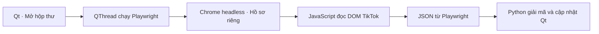

# Báo cáo kỹ thuật StreakKeeper

StreakKeeper là ứng dụng desktop macOS viết bằng Python và PySide6. Bản dev dùng Chrome headless với hồ sơ riêng để đọc TikTok Web và chạy giữ chuỗi. Chế độ `--demo` dùng dữ liệu giả để học và thử quy tắc gửi, tạm dừng và thử lại. Hai chế độ dùng hai tệp SQLite riêng.

## 1. Sửa code có cập nhật ứng dụng đã cài không?

Bản `/Applications/StreakKeeper.app` chứa mã Python và các thư viện tại thời điểm PyInstaller đóng gói. Khi sửa mã trong workspace, bản cài vẫn sử dụng mã bên trong bundle. Để thấy thay đổi ngay trong quá trình học, hãy thoát tiến trình đang chạy rồi mở từ source bằng `uv run streakkeeper`. Lệnh này cũng cần chạy lại sau mỗi lần sửa vì app chưa có hot reload.

| Bạn muốn làm gì | Cách chạy |
| --- | --- |
| Thử code mới với Chrome | `uv run streakkeeper` |
| Học luồng gửi bằng dữ liệu giả | `uv run streakkeeper --demo` |
| Cập nhật bản tìm thấy trong Applications | Build lại `.app`, thoát bản cũ, thay bundle và mở lại |

Bấm nút đỏ có thể chỉ ẩn cửa sổ xuống thanh menu. Chọn **Thoát** trong menu StreakKeeper trước khi mở lại cùng thư mục dữ liệu. App khóa một tiến trình cho mỗi chế độ trong thư mục đó. Bản đọc thật lưu cài đặt tại `~/Library/Application Support/StreakKeeper/app.sqlite3`. Bản mô phỏng dùng `demo.sqlite3` trong cùng thư mục. Việc thay bundle trong Applications giữ nguyên các cơ sở dữ liệu ở vị trí này.

## 2. Bản đồ mã nguồn

| Tệp | Vai trò |
| --- | --- |
| [app.py](src/streakkeeper/app.py) | Điểm vào `main()`, giao diện Qt, thanh menu, lịch chạy và kết nối các nút với hành động |
| [theme.py](src/streakkeeper/theme.py) | Qt Style Sheet cho nền, panel, nút, bảng và các trạng thái |
| [tiktok.py](src/streakkeeper/tiktok.py) | JavaScript trích thông tin từ giao diện TikTok Web |
| [streak_browser.py](src/streakkeeper/streak_browser.py) | Khởi chạy Chrome headless, xác nhận tài khoản và thực hiện thao tác trên hộp thư |
| [core.py](src/streakkeeper/core.py) | Lưu SQLite, tính ngày theo giờ Việt Nam và quy tắc gửi trong mô phỏng |
| [test_core.py](tests/test_core.py) | Kiểm thử quy tắc ngày, tạm dừng, thử lại và số liệu Dashboard |
| [pyproject.toml](pyproject.toml) và [uv.lock](uv.lock) | Khai báo lệnh chạy, dependency và phiên bản đã khóa |

## 3. Từ nút Đọc TikTok đến dữ liệu trên màn hình



1. `Window.run_check()` kiểm tra trạng thái tạm dừng và phiên đọc đang chạy. Trong chế độ mặc định, nó gọi `read_inbox()`.
2. `QThread` mở Chrome headless qua Playwright bằng hồ sơ riêng của app. Cửa sổ Chrome chỉ được mở từ Settings để người dùng đăng nhập trực tiếp.
3. JavaScript đọc các phần tử DOM qua thuộc tính `data-e2e`. Mỗi cuộc trò chuyện có ID, tên và trạng thái đang chọn. Với chat đã chọn và khớp tên tiêu đề, code đếm số hàng tin nhắn, loại văn bản, video, liên kết hồ sơ người gửi và sự hiện diện của ô soạn.
4. App kiểm tra tài khoản trong hộp thư, rồi cập nhật danh sách và phần tóm tắt. Nội dung lịch sử chat chỉ được dùng khi đọc, còn SQLite giữ cấu hình và kết quả kiểm tra.

**Điểm cần phân biệt khi đọc kết quả:** số đếm phản ánh các mục TikTok đã tải vào DOM. Mục có ô soạn chỉ cho biết giao diện có vùng nhập. Số tin có liên kết khớp với hồ sơ bên kia giúp nhận diện tin đến trong chat 1–1. Tin từ hồ sơ khác vẫn cần đối chiếu với tài khoản hiện tại trước khi tính là tin đi.

## 4. Vì sao cần chế độ mô phỏng?

`Messages` mô tả hai thao tác mà phần điều phối cần là `inspect(target, day)` và `send(target, content, day)`. `DemoMessages` cung cấp kết quả từ cài đặt, vì vậy có thể thử quy tắc mà không phụ thuộc Chrome, mạng hoặc tài khoản. Đây là ví dụ về việc giữ quy tắc sản phẩm độc lập với phần giao tiếp bên ngoài.

Trong bản dev, `check()` duyệt chat đã bật rồi dùng `attempt()` để xem app đã xác nhận gửi hôm nay chưa. SQLite lưu lần thử theo tài khoản, cuộc trò chuyện và ngày Việt Nam. Lượt gửi thành công khiến các lượt còn lại trong ngày được bỏ qua. Nếu kết quả chưa xác nhận, lần bấm tiếp theo có thể thử lại. Chế độ mô phỏng giữ quy tắc kiểm tra và thử lại riêng để thực hành.

## 5. Lịch chạy và vòng đời cửa sổ

Khi bật lịch tự động, bộ định thời Qt kiểm tra mỗi 15 giây xem còn chat đã chọn mà app chưa xác nhận gửi trong ngày hay không. `streak_schedule.py` tính lượt kế tiếp từ giờ bắt đầu tùy chọn và mốc bắt đầu lượt trước đã lưu. Khi gửi đủ, bộ định thời chờ ngày mới hoặc một chat mới được chọn. Nếu Mac ngủ qua một lượt, nhịp kiểm tra sau khi máy thức sẽ thấy lượt đã đến hạn. Khi tắt lịch tự động, bộ định thời dùng lịch đọc hộp thư mỗi giờ.

Khi có biểu tượng trên thanh menu, đóng cửa sổ gọi `hide()`. Bộ định thời tiếp tục chạy cho tới khi chọn **Thoát**. App hiện chưa tự mở khi đăng nhập macOS.

## 6. Trạng thái tích hợp TikTok

- **Có trong bản cài:** mở hoặc chọn lại tab hộp thư trong cửa sổ Chrome hiện tại. Đọc danh sách đã tải và thống kê chat đang chọn. Mô phỏng quy tắc gửi bằng cờ `--demo`.
- **Đã thử riêng trên trình duyệt:** thấy tin `.` xuất hiện sau thao tác gửi có kiểm soát và nhận diện cuộc trò chuyện đang ghim qua mục **Unpin**. Hai thao tác này chưa được nối vào luồng chạy định kỳ của app.
- **Cần kiểm chứng:** khả năng nhận diện streak và ghim từng tin. Việc thử gửi một tin cũng chưa xác nhận TikTok cho phép tự động gửi định kỳ.

## 7. Bài thực hành trên Mac

Bắt đầu bằng một thư mục dữ liệu thử để tách bài tập khỏi bản đang cài.

```sh
uv run streakkeeper --demo --data-dir "$(mktemp -d /tmp/streakkeeper-learn.XXXXXX)"
uv run python -m unittest discover -s tests -v
```

1. Thêm một người nhận mô phỏng, bật gửi rồi chọn **Kiểm tra ngay** hai lần. Xem lần đầu ghi **Đã gửi** và lần hai ghi **Đã có tin đi**. Đối chiếu với `attempt()` trong `core.py`.
2. Sửa màu của `QPushButton[primary="true"]` trong `theme.py`. Thoát app và chạy lại từ source để thấy đổi màu. Mở bản Applications để so sánh với mã đã đóng gói.
3. Đọc bài test đổi ngày trong `test_core.py`. Đồng hồ được truyền vào `check()` để test chạy qua 00:00 giờ Việt Nam mà không cần chờ đến nửa đêm.

Xem [kế hoạch phát hành](DISTRIBUTION.md) để tìm hiểu bước build `.app`, đóng DMG, ký Developer ID và notarization trước khi phân phối.
